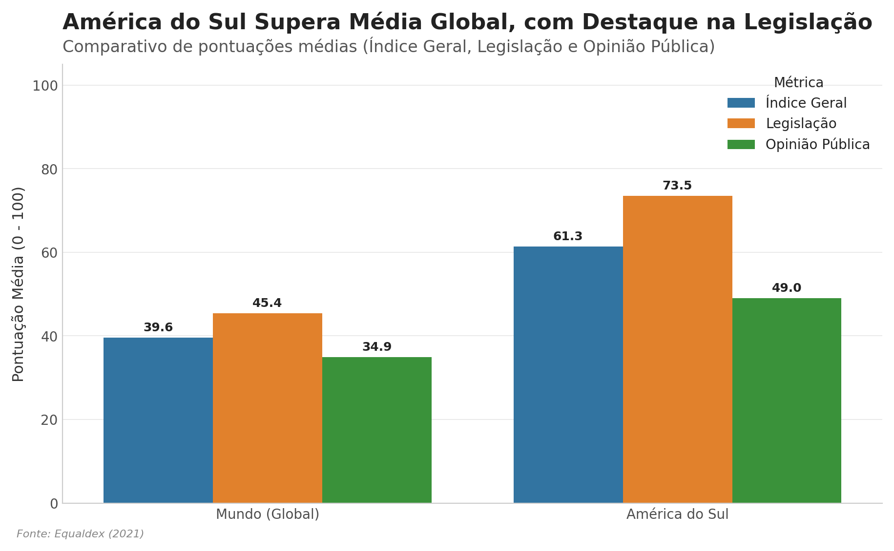
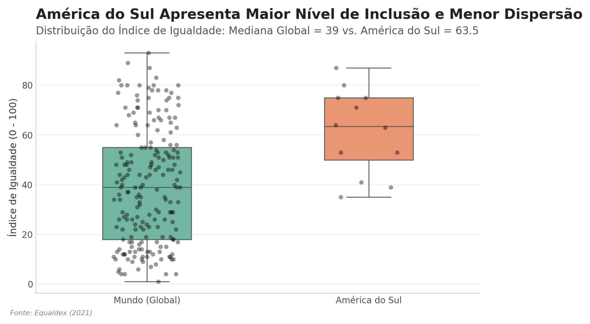
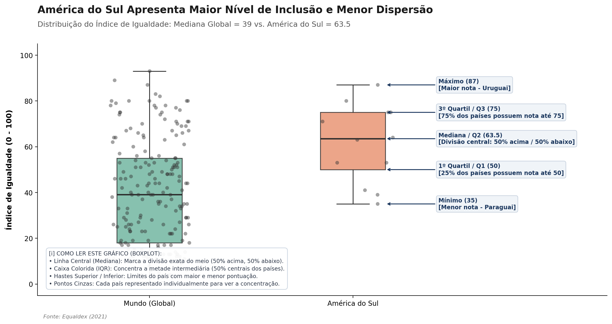
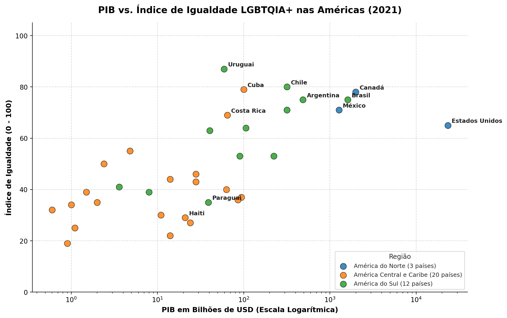
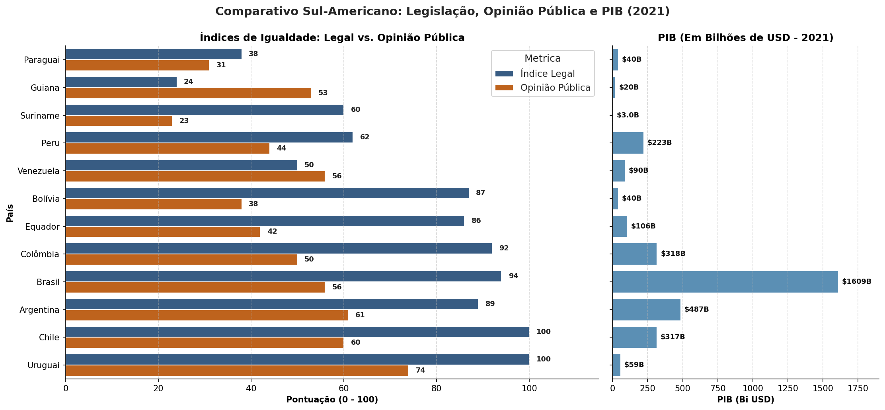

# Data Storytelling: Direitos LGBTQIAPN+, Desenvolvimento Econômico e o Backlash Reacionário na América do Sul 

## Objetivo do Projeto 

Este projeto combina **Engenharia de Dados (Databricks / Spark SQL), Análise Estatística em Python e Teoria Sociológica** para investigar as dinâmicas entre riqueza econômica (PIB), arcabouço legislativo e aceitação social da população LGBTQIAPN+ em 197 países, com foco aprofundado na América do Sul e no Brasil. 

A pesquisa busca responder a duas questões centrais: 

1. *Por que a América do Sul apresenta índices médios de direitos superiores à média global?*
2. *Por que o Brasil, mesmo possuindo uma das legislações mais avançadas do mundo (nota 94/100), continua sendo o país que mais mata pessoas trans e LGBTI+ no mundo?*

--- 

## Arquitetura de Dados no Databricks 
As análises foram construídas no ambiente **Databricks** cruzando dados do *Equaldex (2021)* e do *Banco Mundial (PIB 2021)* via **Spark SQL** e transformados para **Pandas / Seaborn / Matplotlib**: 

* `projeto_piloto_direitos_lgbt`: Base global tratada do Equaldex.
* `indice_idh_global_2021`: Base do PIB global de 2021 em bilhões de USD.
* `direitos_americas_vs_pib_2021`: Tabela unificada das 3 regiões do continente americano.

--- 

##  Análise e Descobertas 

### 1. América do Sul vs. Média Global 

A América do Sul apresenta um Índice de Igualdade médio (**61,33**) significativamente superior à média global (**39,62**).

#### O Contexto Histórico do Avanço Sul-Americano O alto desempenho normativo da América do Sul decorre de três pilares históricos: 

* **Novo Constitucionalismo Latino-Americano (Décadas de 1980/90):**
As Constituições pós-redemocratização inseriram cláusulas pétreas de dignidade humana e não discriminação.
* **A "Maré Rosa" (*Pink Tide* - Anos 2000):**
Governos progressistas impulsionaram leis de vanguarda, como a *Lei de Matrimônio Igualitário* na Argentina (2010) e a *Lei de Identidade de Gênero* no Uruguai.
* **Ativismo Judicial e Sistema Interamericano:**
Diante do bloqueio de congressos conservadores, as Supremas Cortes garantiram direitos com base na **Opinião Consultiva OC-24/17** da Corte Interamericana de Direitos Humanos (Corte IDH).

--- 

### 2. Distribuição e Menor Dispersão Regional 

A análise de distribuição via Boxplot evidencia que a América do Sul não apenas possui uma mediana mais elevada (**63,5** contra **39,0** no mundo), mas também apresenta menor dispersão e concentração de países na metade superior da escala. 

Para visualizar a concentração dos dados e a menor dispersão na América do Sul, apresentamos o modelo de Boxplot em duas visões complementares: 

#### Visão Analítica Padrão: 

 

#### Visão Descritiva / Explicativa (Guia de Leitura dos Parâmetros): 

 

--- 

### 3. A Relação Entre PIB e Direitos nas Américas 

O gráfico de dispersão em escala logarítmica demonstra que o crescimento econômico (**PIB**) atua como um facilitador, mas não como garantia automática de igualdade. 
Na América do Norte, canadenses e norte-americanos combinam alto PIB com elevadas notas sociais. Na América Latina e Caribe, contudo, países de PIB menor (como o Uruguai e a Costa Rica) superam potências econômicas regionais, como o Brasil, nas garantias humanas. 

 

--- 

### 4. Estudo de Caso: O Paradoxo Brasileiro e a Teoria do *Backlash* Reacionário 

Ao analisar os 12 países sul-americanos em detalhe, o Brasil destaca-se como a maior contradição do estudo: 

| Métrica | Pontuação (0 - 100) | Diagnóstico | 
| :--- | :---: | :--- | 
| **Índice Legal (`EI_Legal`)** | **94** | Proteção jurídica equivalente a países desenvolvidos. | 
| **Opinião Pública (`EI_PO`)** | **56** | Baixa aceitação social e forte resistência cultural. | | **Discrepância (*Gap*)** | **38 pontos** | O maior hiato entre norma e sociedade na região. | 

#### 🔍 A Origem da Violência: O Ressentimento de Gênero e o *Backlash* Ultraconservador 

Como explicar que o país com nota 94 em leis seja o líder mundial em assassinatos de pessoas trans e LGBTI+ há 15 anos consecutivos?

A literatura acadêmica em sociologia e direito constitucional (Biroli, 2020; Corrêa, 2021) explica esse paradoxo por meio de três fatores: 

1. **Direitos Conquistados via STF (Sem Consenso Parlamentar):**

As principais conquistas brasileiras — União Homoafetiva ([ADPF 132](https://portal.stf.jus.br/processos/detalhe.asp?incidente=3649911)), Nome Social sem cirurgia ([ADI 4275](https://portal.stf.jus.br/processos/detalhe.asp?incidente=3701662)) e Criminalização da Homotransfobia ([ADO 26](https://portal.stf.jus.br/processos/detalhe.asp?incidente=4215918)) — foram concedidas pelo Supremo Tribunal Federal. 

O avanço legal ocorreu no papel sem um processo correspondente de aculturação e debate legislativo na sociedade. 

2. **A Hipótese do *Backlash* e do Ressentimento de Gênero:**

A percepção de avanço dos direitos das minorias é interpretada por setores ultraconservadores como uma ameaça à ordem patriarcal e à hegemonia cis-heteronormativa. A reação a esse avanço gera um **ressentimento de gênero**, alimentado por uma nostalgia de um passado onde apenas pessoas cis-heterossexuais possuíam voz e direitos aparentes.

3. **Pânicos Morais como Autorização para a Violência:**

Movimentos reacionários instrumentalizam discursos contra a chamada "ideologia de gênero" e a "ameaça à família tradicional" para transformar a população LGBTQIAPN+ no "inimigo moral". 

Essa desumanização discursiva atua como uma **autorização social e simbólica para a violência física e mortal** nas periferias urbanas. 

--- 

## Conclusões e Recomendações ESG 

* **Para Empresas:**
Na América do Sul, a conformidade legal (*compliance*) não garante um ambiente seguro. É indispensável implementar políticas ativas de diversidade interna, segurança e apoio psicológico para colaboradores LGBTQIAPN+. 

* **Para Políticas Públicas:**
Para fechar o **hiato de 38 pontos** entre o avanço legislativo/jurídico do STF e a aceitação na opinião pública — e estancar a violência fatal contra a população LGBTQIAPN+ no Brasil —, as políticas públicas devem atuar em um **continuum integrado de curto, médio e longo prazo**, onde cada medida serve de sustentação para a seguinte:

### Fluxo de Ação Integrado 

> **EDUCAÇÃO INFANTIL (A Base)**
> * **Foco:** Desconstrução de papéis rígidos e prevenção primária do preconceito.
> * **Impacto:** *Previne o preconceito futuro.*

↓

> **CONSCIENTIZAÇÃO DE ADULTOS & SOCIEDADE CIVIL (O Presente)**
> * **Foco:** Parcerias públicas (ex: Casa 1) e campanhas diretas sem dependência do Congresso.
> * **Impacto:** *Transforma a cultura atual.*

↓ 

> **MEDIDAS DE TRANSIÇÃO E SEGURANÇA FÍSICA (A Ponte Imediata)**
> * **Foco:** Combate à subnotificação policial e garantia da vida enquanto a opinião muda.
> * **Impacto:** *Garante a sobrevivência e a proteção imediata.*

---

### 1. A Base: Educação Infantil e Desconstrução de Estereótipos de Gênero 

A prevenção primária da violência de gênero e do preconceito exige uma intervenção estrutural na primeira infância, desmantelando a rigidez dos papéis sociais antes que se convertam em ressentimento ou aversão na vida adulta. 

* **O Modelo Internacional de Referência (Suécia / Países Nórdicos):**
Na Suécia, pré-escolas públicas como a renomada [*Egalia*](https://www.skolverket.se/) em Estocolmo, amparadas pelas diretrizes do Conselho Nacional de Educação Suco (*Skolverket*), aplicam a pedagogia de equidade de gênero nos anos iniciais. O modelo incentiva meninos a desenvolverem habilidades de cuidado, empatia e manutenção de tarefas domésticas, enquanto encoraja meninas a praticarem exercícios físicos mais intensos, atividades manuais pesadas e posições de liderança. [Estudos da Universidade de Uppsala](https://www.uu.se/) comprovam que crianças expostas a esse ambiente desenvolvem significativamente menor propensão a aplicar estereótipos discriminatórios e apresentam maior tolerância à diversidade. 

* **Impacto no Brasil:**
A implementação de diretrizes pedagógicas inclusivas nos anos iniciais da educação básica é o único caminho capaz de formar gerações imunes a pânicos morais reacionários.

--- 

### 2. Conscientização de Adultos e Fortalecimento da Sociedade Civil 

Frente à atual conjuntura política do Brasil, onde alas e partidos ultraconservadores formam bancadas expressivas no Congresso Nacional e no Senado, impondo forte resistência e travamento a revisões do Plano Nacional de Educação (PNE), as políticas públicas não podem ficar reféns da aprovação legislativa nacional. 

* **A Hipótese da Estratégia de Contorno Institucional:** O Poder Executivo (em nível federal, estadual e municipal) pode focar em ações diretas que não necessitam de alteração de leis federais:

1. **Campanhas Socioeducativas de Utilidade Pública:**
Mídias de massa e redes sociais mantidas por incentivo público para disseminar informações sobre dignidade humanitária, diversidade de gênero e direitos garantidos pela Constituição.

2. **Parceria e Fomento Público a Coletivos Ativos:**
Em vez de criar estruturas do zero, o Estado pode facilitar a disponibilização de recursos e investimentos a editais já existentes para Organizações da Sociedade Civil (OSCs) que já realizam trabalho de acolhimento e cultura na ponta.

3. **Estudo de Caso — Casa 1 (São Paulo):**
O [Centro de Cultura e Acolhida Casa 1](https://www.casaum.org/) é uma referência nacional no acolhimento de jovens LGBTQIAPN+ expulsos de suas casas, oferecendo moradia temporária, atendimento psicoterápico, saúde e cursos preparatórios. A ampliação de convênios governamentais com equipamentos como a Casa 1 garante a sobrevivência imediata e a autonomia financeira dessa população vulnerável.

--- 

### 3. Medidas de Transição: Proteção Física e Enfrentamento à Subnotificação

Como a mudança na opinião pública e na cultura (Seções 1 e 2) é um processo gradual que leva anos para se refletir nos indicadores sociais, é imperativo assegurar a manutenção **medidas transitórias de segurança física e respaldo legislativo** para garantir a integridade da população LGBTQIAPN+ durante o período de transição, enfatizando o combate a subnotificação de ocorrências de atos de violência a população lgbtqiapn+ e garantindo, por exemplo, a obrigatoriedade em âmbito federal de campos como identidade de gênero, orientação sexual, nome social, cor e raça no momento do preenchimento de boletins de ocorrência em casos de crimes relacionados a racismo e/ou lgbtfobia. 

## Fontes Verificáveis e Artigos Acadêmicos 

### Bases de Dados Oficiais 

* [Equaldex - Global LGBT Rights Index](https://www.equaldex.com/)
* [World Bank Open Data - GDP 2021](https://data.worldbank.org/indicator/NY.GDP.MKTP.CD)

### Educação e Experiências Internacionais 

* [Swedish National Agency for Education (Skolverket) - Gender Equality in School](https://www.skolverket.se/)
*  [Uppsala University - Gender Equality & Child Development Research](https://www.uu.se/)

### Monitoramento de Violência e Direitos Humanos

* [Centro de Cultura e Acolhida Casa 1 (SP)](https://www.casaum.org/)
* [ANTRA - Associação Nacional de Travestis e Transexuais (Dossiês de Assassinatos)](https://antrabrasil.org/)
* [Grupo Gay da Bahia (GGB) - Relatórios Anuais de Mortes Violentas](https://grupogaydabahia.com.br/)
* [TGEU - Transgender Europe (Trans Respect versus Transphobia Project)](https://transrespect.org/)

### Precedentes Jurídicos do STF e Corte IDH 

* [STF - Acórdão da ADPF 132 (União Homoafetiva)](https://portal.stf.jus.br/processos/detalhe.asp?incidente=3649911)
* [STF - Acórdão da ADI 4275 (Identidade de Gênero)](https://portal.stf.jus.br/processos/detalhe.asp?incidente=3701662)
* [STF - Acórdão da ADO 26 (Criminalização da Homotransfobia)](https://portal.stf.jus.br/processos/detalhe.asp?incidente=4215918)
* [Corte IDH - Opinião Consultiva OC-24/17 (Igualdade e Identidade de Gênero)](https://www.corteidh.or.cr/)

### Literatura Acadêmica sobre Ofensiva Antigênero e *Backlash*

*  **BIROLI, Flávia (2020).** *[Gênero, "valores familiares" e democracia](https://www.scielo.br/j/rbcsoc/a/7SpzDfsnBgdBBHjrKsjXTpc/?format=html&amp;lang=pt)*. In: Gênero, Neoconservadorismo e Democracia, Boitempo.
* **CORRÊA, Sonia (2021).** *[Políticas antigênero na América Latina: resumos dos estudos de casos nacionais](https://www.scielo.br/j/rbcsoc/a/7SpzDfsnBgdBBHjrKsjXTpc/?format=html&amp;lang=pt)*. ABIA / Cadernos Pagu.
* **SILVA, Elder Luan Santos (2022).** *[Neoconservadorismo e Ofensivas antigênero no Brasil: A mobilização da “Ideologia de Gênero” e a produção de LGBTfobias](https://doi.org/10.31560/2595-3206.2021.14.12172)*. Revista Brasileira de Estudos da Homocultura.
* **REVISTA CONSTITUIÇÃO E GARANTIA DE DIREITOS (2020).** *[Decisões progressistas e backlash: reações conservadoras ao reconhecimento judicial do direito](https://periodicos.ufrn.br/constituicaoegarantiadedireitos/article/view/20176)*. UFRN.

  
